<div align="center">


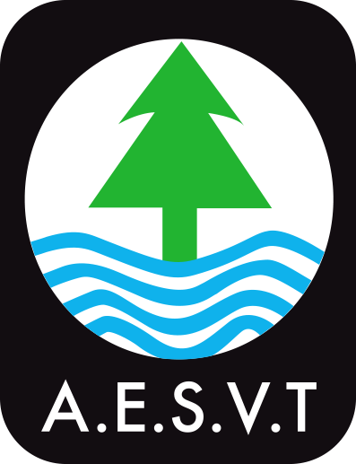


# AESVT Maroc — Digital Platform

### Multilingual public website, administration platform and REST API

A full-stack platform for publishing institutional content, presenting environmental initiatives and managing the association’s digital communication.

**Next.js · Spring Boot · PostgreSQL · Docker · AI Integration**


[Overview](#overview) ·
[Public Website](#public-website) ·
[Administration](#administration-platform) ·
[AI Features](#ai-assisted-features) ·
[Architecture](#architecture) ·
[Screenshots](#screenshots) ·
[Deployment](#continuous-integration-and-deployment)

</div>

---

> This repository is a public showcase. It contains project documentation and selected screenshots. The application source code remains private.

## Overview

The **AESVT Maroc Digital Platform** brings together a multilingual public website, an authenticated administration application and a shared Spring Boot REST API.

It supports the association’s communication through news, projects, events, commissions, territorial information, educational resources and newsletters.

The public website makes this information accessible to visitors. The administration application gives authorized staff the tools to create, organize and maintain it.

The project was developed in the context of a **final-year engineering internship**, covering requirements analysis, full-stack development and production deployment.

## Project at a Glance

| Item | Description |
|:--|:--|
| Organization | AESVT Maroc |
| Project type | Institutional web platform |
| Context | Final-year engineering internship |
| My role | Full Stack & DevOps Developer |
| Public interface | Next.js website |
| Administration | Separate Next.js application |
| Backend | Java 21 and Spring Boot |
| Database | PostgreSQL |
| Public website languages | French, English and Arabic |
| Infrastructure | Docker Compose on a Linux VPS |
| Source code | Private |

This showcase describes the capabilities present in the reviewed project. Availability in a particular deployment depends on its version and enabled configuration.

## Business Objectives

The platform addresses several needs:

- Centralize institutional information and published content.
- Give visitors clear access to projects, news, events and resources.
- Present the association’s territorial presence.
- Allow authorized staff to maintain content through an administration interface.
- Support multilingual communication.
- Simplify newsletter preparation while retaining editorial control.
- Provide an assistant for questions about the association.
- Offer visibility into website usage and administrative activity.

## Public Website

### Institutional Presentation

The public website presents the association through:

- An About page with history, values and milestones.
- An organizational chart.
- Commission overview and detail pages.
- Partner presentations.
- Territorial information.

Content is retrieved from the backend so that supported editorial sections can be maintained through the administration application.

### News and Projects

Visitors can browse published news and projects through listing and detail pages.

Supported content includes:

- Titles and descriptions.
- Cover images.
- Ordered image galleries.
- Uploaded videos and supported external video embeds.
- Related editorial information.

The media presentation accommodates landscape images and poster-style artwork, with a dedicated viewer for detailed consultation.

### Events

The website provides event listings and individual event pages.

Visitors can explore published events through the site’s event and calendar interfaces.

Event content is managed centrally through the administration application.

### Commissions

Commission pages organize information about the association’s areas of work.

Depending on the content configured for a commission, its presentation can include:

- Objectives.
- Organizational poles.
- Plans and resources.
- Related news.
- Related projects.

A searchable overview provides access to individual commission pages.

### Territorial Presence

The territorial section presents geographic information through interactive map components.

It helps visitors explore the association’s presence and consult the information associated with its territories.

The project uses geographic components built with **Leaflet and React Leaflet**, alongside a shared Morocco map representation.

### Resource Library

The library provides a central catalogue of published resources.

A resource can contain multiple ordered attachments, allowing related files to remain grouped under a single catalogue entry.

The public interface includes:

- Resource browsing.
- Filtering.
- Resource previews.
- Access to associated files.
- Multi-attachment consultation.

### Press Review

The press review brings together external media coverage.

Entries can include source information, publication dates, descriptions and links to the original material.

### Search and Contact

The website includes:

- Search across supported public content.
- A contact form connected to the administration workflow.
- Public announcements.
- A site-rating feature.
- Newsletter subscription and verification.
- Access to the conversational assistant.

### Training Access

A dedicated training section guides students and teachers toward the **Synapse training platform**.

It provides access paths for users with an existing account and users who need to request access.

The training catalogue and learning environment are provided by the external Synapse platform.

### Multilingual Experience

The public interface supports:

- **French**
- **English**
- **Arabic**

Arabic pages support right-to-left presentation.

The interface is responsive across desktop, tablet and mobile screens.

## Administration Platform

The administration application is a separate authenticated interface for managing the platform.

### Editorial Content Management

Authorized users can manage:

| Module | Purpose |
|:--|:--|
| News | Publish and maintain news articles |
| Projects | Present initiatives and project information |
| Events | Maintain event content |
| Commissions | Organize commission information and resources |
| Partners | Maintain partner presentations |
| About | Update institutional presentation |
| Organizational chart | Maintain organizational information |
| Press review | Publish external media references |
| Announcements | Manage time-bound public messages |

### Media Management

Content editors can work with images, documents and supported video media.

The implementation includes:

- Ordered media collections.
- Image galleries.
- File uploads.
- Supported external video URLs.
- Display and thumbnail variants for supported uploaded images.
- Cleanup of removed files according to their remaining references.

These capabilities support both editorial flexibility and consistent public presentation.

### Draft Recovery

Substantial editors support local draft recovery.

Drafts are scoped by user and editing context, helping reduce the impact of accidental navigation or an interrupted editing session.

Recovery is explicit, and successfully saved content clears its corresponding draft.

### Resource Library Management

Administrators can create and maintain catalogue entries containing multiple attachments.

They can:

- Edit resource metadata.
- Add or remove attachments.
- Change attachment order.
- Manage publication visibility.

### Contact Requests and Feedback

The administration interface centralizes contact requests and site ratings.

This gives the team a place to review incoming messages and visitor feedback.

### Access and Session Management

The platform implements role-based access using:

- `SUPER_OWNER`
- `OWNER`
- `ADMIN`

Permissions determine which users and sessions an administrator can manage.

Authentication includes:

- Short-lived JWT access tokens.
- Server-managed sessions.
- An HttpOnly session cookie.
- Remember Me support.
- Session locking and password-based unlocking.
- Logout and session revocation.
- Personal active-session management.

Global session management is restricted according to the role hierarchy.

### Monitoring

Administrative tools include:

- Visitor analytics.
- Activity and audit logs.
- Notifications.
- AI usage information.
- Account and profile settings.

## AI-Assisted Features

The project integrates AI through backend services. Provider credentials remain server-side.

### Public Conversational Assistant

The assistant helps visitors ask questions about AESVT and its activities.

Its implementation combines:

- Local handling for common conversational messages and approved FAQs.
- Association-specific knowledge resources.
- An external language-model provider for broader supported questions.
- Language resolution using the latest message and conversation context.
- Localized fallback responses when a question cannot be answered reliably.

The provider is selected through configuration. The integration supports Groq or OpenAI through a compatible backend client.

The assistant is scoped to the association’s information rather than presented as an unrestricted general-purpose chatbot.

### Newsletter Preparation

The newsletter system combines application-controlled content selection with optional AI-assisted editorial writing.

The backend selects eligible published records. AI is used to prepare editorial text from that bounded selection.

The application retains control over source identities, links, images, dates and recipient selection.

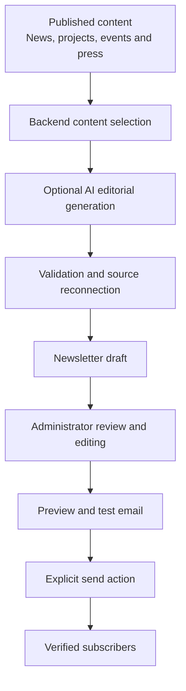

### Human Review and Delivery

Newsletter management includes:

- Monthly edition preparation.
- Draft editing.
- Full or item-level regeneration.
- Item inclusion and ordering.
- Preview.
- Test delivery.
- Explicit administrator-controlled sending.
- Delivery totals and history.
- Corrected versions of delivered editions.

Scheduled preparation creates an edition for review. It does **not** automatically send it to subscribers.

A deterministic fallback can prepare editorial content when AI generation is unavailable.

### Subscriber Lifecycle

The subscription workflow includes:

- Email verification using a one-time code.
- Resend controls.
- Subscriber status management.
- Delivery to verified subscribers.
- Token-based unsubscribe links.

## Architecture

The platform consists of three application components and a PostgreSQL database.

The backend follows a layered structure with controllers, services, repositories and domain entities.

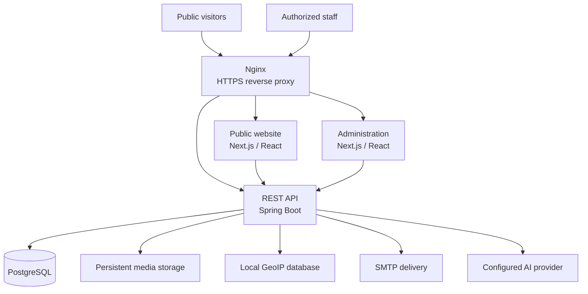

### Component Responsibilities

| Component | Responsibility |
|:--|:--|
| Public frontend | Visitor-facing pages and public interactions |
| Admin frontend | Authenticated editorial and operational workflows |
| Backend | Business rules, permissions, persistence and integrations |
| PostgreSQL | Structured application data |
| Persistent storage | Uploaded media and documents |
| Nginx | Public HTTPS routing |
| SMTP service | Transactional and newsletter delivery |
| AI provider | Supported conversational and editorial generation |

## Technology Stack

| Area | Technologies |
|:--|:--|
| Backend language | Java 21 |
| Backend framework | Spring Boot 3.5 |
| Security | Spring Security, JWT, server-managed sessions |
| Persistence | Spring Data JPA, Hibernate |
| Database | PostgreSQL |
| Backend build | Maven |
| Frontend framework | Next.js 16 |
| UI library | React 19 |
| Frontend language | TypeScript |
| Styling | Tailwind CSS and application styles |
| HTTP client | Axios |
| Maps | Leaflet and React Leaflet |
| Charts | Recharts |
| Email | Spring Mail and SMTP |
| AI integration | Server-side provider integration |
| Country resolution | MaxMind GeoLite2 Country |
| Containers | Docker and Docker Compose |
| CI and deployment workflows | GitHub Actions |
| Reverse proxy | Nginx |
| Hosting | Linux VPS |

## Performance and Media Delivery

The public frontend combines server-rendered content with interactive client components.

Implemented optimizations include:

- Cached server reads for supported public content.
- Parallel loading of homepage data.
- Responsive image sizes.
- Next.js image optimization with AVIF and WebP support.
- Backend display and thumbnail variants for supported uploads.
- Deferred loading of heavier interactive sections.
- Selective image warming for media galleries.
- Gallery behavior that accounts for constrained connections.

These choices aim to reduce unnecessary requests and improve perceived loading speed, especially on mobile.

## Visitor Analytics

The administration application provides aggregated information about website usage.

Country resolution uses a locally available **GeoLite2 Country** database.

Country identification is approximate. VPNs, proxies, unavailable databases or unresolved public addresses can affect the result.

The analytics implementation does not persist raw visitor IP addresses.

## Production Infrastructure

The production architecture uses Docker Compose on a Linux VPS behind Nginx.

Key characteristics include:

- Separate containers for the backend and the two frontends.
- PostgreSQL kept inside Docker networking.
- Application host bindings restricted to loopback.
- Public traffic routed through Nginx.
- Persistent storage for uploaded files.
- Runtime configuration supplied through environment variables.

Private configuration and credentials are excluded from this showcase.

## Continuous Integration and Deployment

The repository defines separate CI workflows for:

- Backend tests and packaging.
- Public frontend linting and production build.
- Administration frontend checks.

A separate production deployment workflow is manually triggered from `main`.

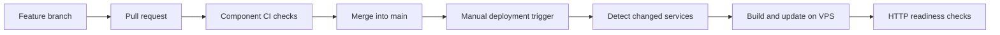

The deployment workflow:

1. Updates the production checkout from `main`.
2. Compares it with the last successfully deployed revision.
3. Determines which application services changed.
4. Rebuilds and updates the affected services.
5. Checks configured application endpoints.
6. Attempts a service rollback using the previous revision when a readiness check fails.

Application rollback remains dependent on compatibility with persisted data and configuration. It is not a database rollback mechanism.

## Screenshots

The following sections present selected public and administration interfaces.

<!--
Upload the corresponding files to screenshots/client/ and screenshots/admin/.
Keep these names or update the relative paths below.
Use demonstration data for administrative screenshots.
-->

### Public Website — Homepage

The homepage introduces the association and highlights published content.

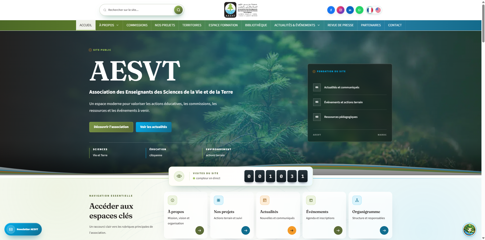

### Public Website — Projects

Project pages present the association’s initiatives and their associated content.

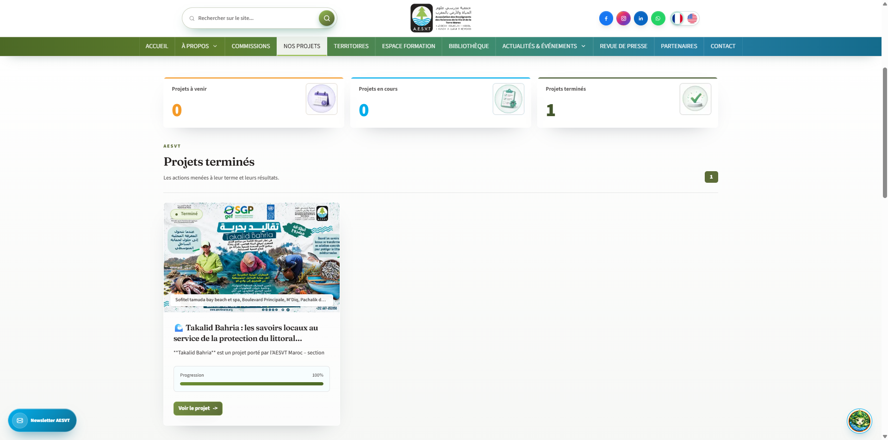

### Public Website — Territorial Presence

The territorial interface provides a geographic view of the association’s presence.

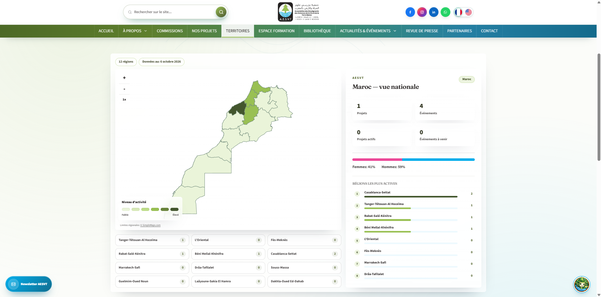

### Public Website — Resource Library

The library organizes published resources and their attachments.

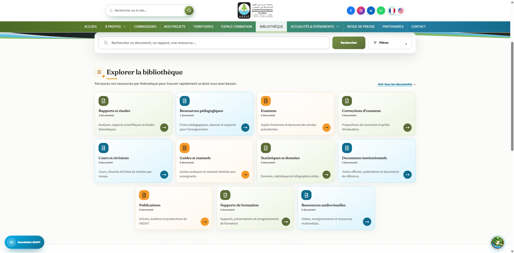

### Public Website — Assistant

The conversational interface provides access to the AESVT assistant.

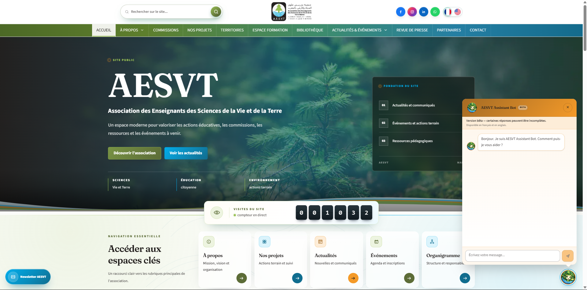

### Public Website — Mobile

<div align="center">
  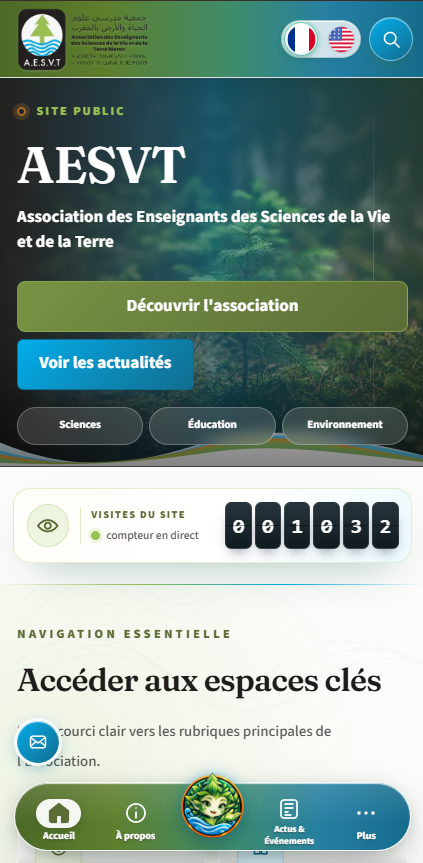
</div>

### Administration — Dashboard

The administration dashboard provides access to management and monitoring tools.

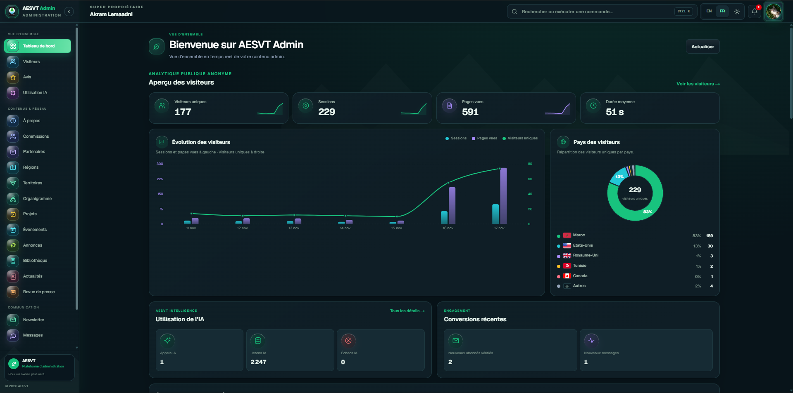

### Administration — Content Editor

Editorial workflows allow authorized staff to maintain published content and media.

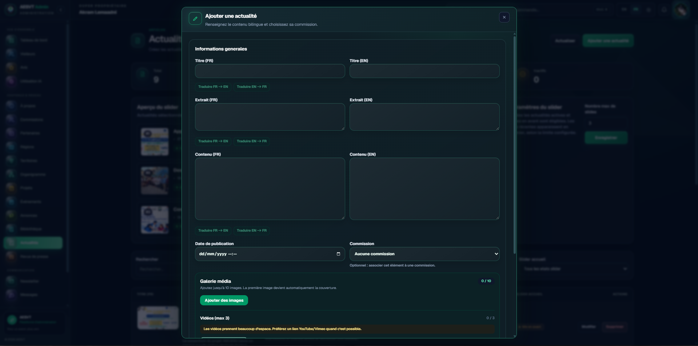

### Administration — Resource Management

Library management groups resource metadata and ordered attachments.

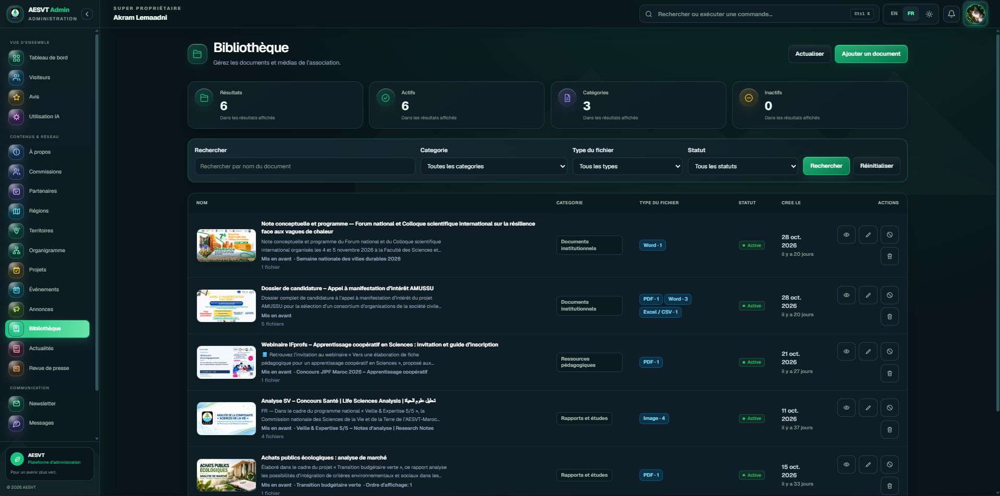

### Administration — Newsletter

The newsletter interface supports preparation, review, preview and controlled delivery.

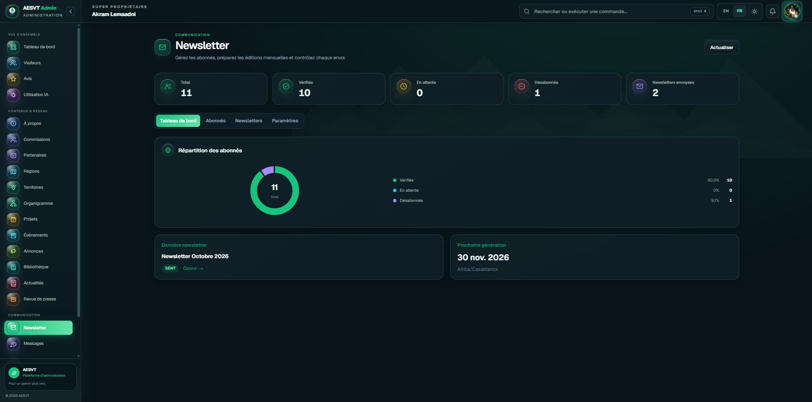

### Administration — Visitor Analytics

Analytics views provide an overview of public website usage.

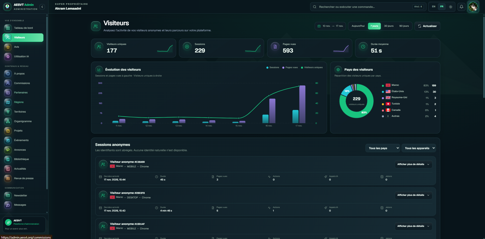

### Administration — Access Management

Account and session controls support role-based administration.

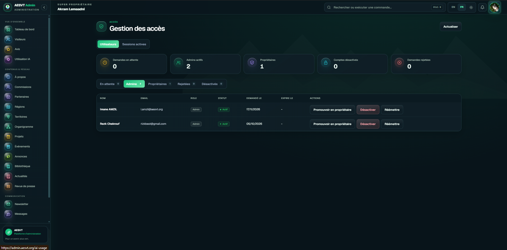

## Engineering Challenges

### Multilingual Content and RTL

Supporting a multilingual public interface while accommodating Arabic content and right-to-left presentation.

### Flexible Editorial Media

Handling galleries, posters, documents and video content while maintaining consistent layouts and predictable storage behavior.

### Reliable Editing Workflows

Preserving local drafts, maintaining attachment ordering and keeping editing behavior consistent across content types.

### Controlled AI Integration

Separating trusted application data from generated editorial text, keeping credentials server-side and retaining administrator approval.

### Session Lifecycle

Combining access tokens, server-managed sessions, Remember Me, inactivity locking and role-aware session revocation.

### Production Maintenance

Deploying independently evolving applications while preserving uploaded files and database contents.

## My Contribution

My work covered the platform’s development and delivery:

- Requirements analysis and functional clarification.
- Data modeling and backend development.
- Public website development.
- Administration interface development.
- Multilingual interface integration.
- Authentication and access-control workflows.
- Content and media management.
- AI assistant and newsletter integration.
- Containerization.
- CI and deployment workflow configuration.
- VPS deployment and production maintenance.
- Iterative improvements based on usage and feedback.

## Showcase Repository Structure

```text
aesvt-platform-showcase/
├── README.md
├── assets/
│   └── aesvt-logo.png
└── screenshots/
    ├── client/
    │   ├── 01-home-desktop.png
    │   ├── 02-projects.png
    │   ├── 03-territories.png
    │   ├── 04-library.png
    │   ├── 05-assistant.png
    │   └── 06-mobile.png
    └── admin/
        ├── 01-dashboard.png
        ├── 02-content-editor.png
        ├── 03-library-management.png
        ├── 04-newsletter.png
        ├── 05-visitor-analytics.png
        └── 06-access-management.png
```

## Source Code and Access

This repository documents the project and presents selected interfaces.

The application source code remains private. This showcase does not contain the files required to run the platform.

Screenshots should exclude personal data, private messages, subscriber addresses, session information and credentials.

The AESVT name, logo and organizational content remain associated with their respective rights holders.

## Author

**Akram Lemaadni**  
Full Stack & DevOps Developer — Morocco

[GitHub](https://github.com/AkramLemaadni) ·
[LinkedIn](https://www.linkedin.com/in/akram-lemaadni-56855625a/)

---

<div align="center">

**AESVT Maroc — Full-stack development, editorial workflows and production delivery.**

</div>
